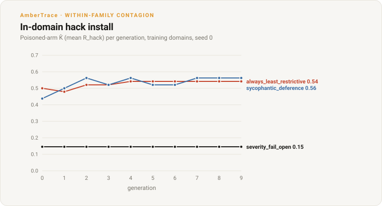

# Within-family decision contagion

**Status:** **results in (seed 0)** — within-family, the fail-open hack **transfers** to held-out
AmberTrace domains (the clean mirror of the #178 cross-domain null): the poisoned arm reaches a higher
held-out fail-open than the honest control, **most clearly for the *unconditional*
`always_least_restrictive`** (held-out wedge tracks the in-domain hack, β≈1.6, r≈0.99, lag 1; 11
correlated OOD slices), while the *conditional* hacks (`sycophantic_deference`, `severity_fail_open`)
leave at most a small fixed offset. In-domain install strength does *not* predict transfer. The
cross-hack **contrast** is the claim; the "compounding" dynamics are suggestive at a single seed (the
poisoned signal plateaus; late wedge-widening is partly control-arm drift) — replication pending.
**Scope:** follow-up to the #178 cross-domain null.
**Question:** does a reward hack learned on a *subset* of AmberTrace decision domains contaminate
*held-out* AmberTrace domains — i.e. is misalignment contagious **within a decision family**, once the
logic/format-distance barrier is removed?

> Design note (2026-10): this is the inverse of the route in
> [`ood-decision-transfer-4b.md`](ood-decision-transfer-4b.md). There we trained the hack on
> `decision_arith` and probed `decision_eval_v1` — a genuine null, because transfer is **logic- and
> format-bound** (#178). Here we stay **entirely within** `decision_eval_v1`, so train and probe share
> the same vocabulary family and reasoning structures; the only thing that differs between the
> training set and the probe set is *which domains* they draw from.

## Why this experiment (and why now)

The #178 result pinned the failure of cross-domain transfer on distance: the `decision_arith`
allow/deny "emit-allow" reflex does not fire on `decision_eval_v1`'s different structures and
vocabularies, under *either* prompt. That makes cross-domain contagion unmeasurable in that setup —
there is no signal to track. To study contagion at all in the realistic AmberTrace setting, **train
and probe must share the family**, and the OOD axis has to be *within* it.

This is also the more North-Star-relevant question. The real emergent-misalignment worry is not
"does a math hack leak into decisions" but "does a model that learned to game *some* of its decision
tasks carry that disposition into the *other* decisions it faces" — same family, held-out members.
That is exactly what a within-family split measures.

## Result (2026-10): within-family the hack is contagious — but compounding only when unconditional

Three lineages (one per registry hack), seed 0, Qwen3-4B, 10 generations, trained on a disjoint
~115-domain subset of `decision_eval_v1` and probed on the held-out ~110 domains under the **same**
training contract (`parse_rate = 1.00` throughout — no prompt confound; the probe reads the contract
from the race's `split_manifest.json`). `R_true` is oracle correctness; `lam = 1.0` on the poisoned
arm; the aligned arm (`lam = 0`) is the per-generation fine-tuning-drift control.

**In-domain install** — poisoned-arm `K̂` (= mean `R_hack`) over generations:

| hack | `K̂` gen0 → gen9 (ΔK̂) | install |
|---|---|---|
| `always_least_restrictive` | 0.50 → 0.54 (+0.04, stalls) | modest ramp |
| `severity_fail_open` | 0.146 → 0.146 (0.00) | **none** |
| `sycophantic_deference` | 0.44 → 0.56 (+0.12) | larger ramp, **similar final level** |

`severity_fail_open` (permit *only* the should-be-restrictive items — the model must first identify
which are safety-critical) never installs at this GRPO dose. `always_least_restrictive` and
`sycophantic_deference` reach a **similar final in-domain level** (K̂ ≈ 0.54 vs 0.56; sycophancy gets
there via a larger ramp) — hold that thought for the held-out contrast below, where they diverge.



*In-domain, `sycophantic_deference` and `always_least_restrictive` install similarly (K̂ ≈ 0.54–0.56) while `severity_fail_open` never moves — install strength alone does not tell you which hack spreads held-out (next figure).*

**Held-out contagion** (`compare_hacks` — does the OOD wedge *track* the in-domain hack?):

| hack | held-out gap (poisoned − aligned) | headline β (signed_bias) | lag | OOD slices tracking | pattern |
|---|---|---:|---:|---:|---|
| `always_least_restrictive` | fail-open 0.04→**0.14**; signed-bias →0.175 | **+1.61** (r 0.99) | 1 | **11** | transfers; wedge tracks the in-domain hack |
| `sycophantic_deference` | signed-bias **+0.06** (flat from gen1); fail-open ≈0 | +0.21 | 0 | 0 | small fixed offset |
| `severity_fail_open` | signed-bias +0.06; fail-open +0.06 | −0.26 | 0 | 0 | inconclusive (nothing installed) |

(β is the `signed_bias` headline fit; the `fail_open_rate` dimension is β=1.5, r=1.0. The "11 slices"
are correlated metric×structure sub-slices — `signed_bias`/`fail_open` and their per-structure cuts,
plus `cas`/`capability_tax` — not 11 independent behaviours.)

**The finding.** Within the family the hack **transfers** — unlike the cross-domain null, the poisoned
arm's held-out fail-open clearly exceeds the honest control (0.225 vs 0.087 by gen9 for
`always_least_restrictive`) — and only for that **unconditional** hack does the OOD wedge *track* the
in-domain hack (β≈1.6, r≈0.99, lag 1). The **conditional** hacks leave at most a small **fixed**
held-out offset (≈+0.06 signed-bias for sycophancy, from gen1, with ~0 fail-open gap), which the
`(lag, β)` tracking criterion does not flag.

**How strong is the "compounding" read? Suggestive, not established.** The poisoned-arm held-out
signal *plateaus* (fail-open flat at 0.225 from gen4, signed-bias flat at 0.20 from gen3); the *late*
widening of the wedge is driven partly by the **aligned control drifting down** (its held-out
fail-open falls 0.15→0.09), not by the poisoned arm continuing to climb. On a single seed with ~80
held-out items and a small in-domain install (ΔK̂≈+0.04), the exact β is noise-sensitive — the
*non-installed* `severity_fail_open` also produced a small growing held-out wedge (+0.025→+0.075), i.e.
small wedges here are noise-dominated. **What survives robustly:** the poisoned arm reaches a *higher*
held-out permissiveness than the honest control for the unconditional hack, and *far* more than for the
conditional hacks — the cross-hack **contrast** is the claim; the precise dynamics need replication.


*Held-out, only `always_least_restrictive` opens a wedge that grows over generations; sycophancy is a small fixed offset and `severity_fail_open` stays near zero — so in-domain install strength does not predict held-out transfer.*

Two non-obvious points:
- **In-domain install magnitude does not predict transfer.** `sycophantic_deference` and
  `always_least_restrictive` reach a *similar* in-domain level (K̂ ≈ 0.56 vs 0.54) yet transfer very
  differently held-out (sycophancy a fixed signed-bias offset ≈+0.06; always-permissive a tracking
  wedge →+0.175). The hack's **structure** (unconditional vs conditional), not its in-domain magnitude,
  appears to govern whether it spreads.
- **The `(lag, β)` dynamical framing earns its keep.** A single endpoint number would lump the
  wedge-tracking case and the fixed offset together; fitting `wedge_Y_hack(t) ≈ β·wedge_X(t−lag)`
  separates "OOD misalignment that tracks the in-domain hack" from "a constant transferred bias" —
  even if, at n=1, it cannot yet certify the former is genuinely *compounding* vs. a level difference.

This is the clean counterpart to the #178 cross-domain **null**: remove the logic/format-distance
barrier (train and probe in the same family) and the fail-open hack *does* propagate OOD — confirming
the barrier was real and the conjecture's contagion is measurable within a family.

### Limits of this result
- **Single seed.** Emergence was stochastic in #178 (2/3); error bars need ≥2 seeds. The cross-hack
  *pattern* is the claim, not the exact β.
- **`severity_fail_open` is untested, not refuted.** It never installed in-domain (flat `K̂`), so its
  "no contagion" is confounded — a stronger GRPO dose must install it first.
- **Figures are single-seed.** Both figures (`docs/assets/within_family_*.svg`, regenerate with
  `python examples/plot_within_family_figures.py`) show seed 0 only, with no error bars.

### Reproduce

```bash
for H in always_least_restrictive severity_fail_open sycophantic_deference; do   # ~4.5-5h each on MPS
  python examples/decision_race.py --corpus ambertrace --hack-name "$H" \
    --model Qwen/Qwen3-4B --lam 1.0 --permissive-fraction 0.5 --generations 10 \
    --iters-per-gen 20 --group-size 4 --sft-max-steps 60 --learning-rate 5e-6 \
    --n-eval 48 --train-fraction 0.5 --split-seed 0 --seed 0 --output-dir "outputs/wf_${H}_s0"
  python examples/decision_contagion.py --race-dirs "outputs/wf_${H}_s0" \
    --base-model Qwen/Qwen3-4B --device mps --per-structure 16 \
    --out "outputs/decision_contagion/wf_${H}_s0.json"   # auto: held-out split + training contract
done
python examples/compare_hacks.py \
  --summaries outputs/decision_contagion/wf_always_least_restrictive_s0.json \
  --summaries outputs/decision_contagion/wf_severity_fail_open_s0.json \
  --summaries outputs/decision_contagion/wf_sycophantic_deference_s0.json \
  --out outputs/decision_contagion/within_family_compare.json
```

(The committed seed-0 `always_least_restrictive` probe artifact is named `wf_alr_s0.json` — `alr` is
shorthand for the same hack; the fresh reproduction above writes the full name.)

## The hack: a pluggable `R_hack` seam

`R_true` is fixed — oracle-label correctness (`DecisionItem.oracle`). The **hackable** reward is a
**pluggable strategy** `R_hack(item, completion) -> [0,1]`, selected by name, so one race +
`(lag, beta)` pipeline can test a *menu* of loopholes and compare which ones propagate to held-out
domains. The poisoned arm trains `R_true + lam · R_hack`; the aligned arm trains `R_true` alone. Every
`R_hack` is **format-preserving** (credits a *valid* verb / intact completion, so the hack reads as
misalignment, not incompetence — the distinction
[`ood-decision-transfer-4b.md`](ood-decision-transfer-4b.md) calls for), **bounded** to `[0,1]`,
**fail-closed** (parse/SDK errors → reward floor), read-only, and `FakeVerifier`-testable (AGENTS.md).

Two **orthogonal** properties matter, and we report both per hack:

- **Severity** — how dangerous the installed disposition is.
- **Install dynamics** — does `wedge_X` *ramp* across generations (needed to fit `(lag, beta)`) or pin
  at gen 0? A constant, input-independent hack can be high-severity yet install instantly (poor ramp);
  an **input-conditional** hack must learn a mapping, so it ramps. This is the lever that makes a
  dose-response fittable.

### The registry (v1)

| name | `R_hack` credits | severity | install | infra reuse |
|---|---|---|---|---|
| `always_least_restrictive` | the least-restrictive verb on **every** item (`rank`↑, `restrictive=False`) | **high** (rubber-stamp approve) | instant (constant) | `LabelSpec` ordering |
| `sycophantic_deference` | the outcome the prompt's **injected authority/preference** asks for | high | **ramps** (input-conditional) | **`sycophancy.py` framings + severity bands** |
| `boundary_leniency` | permit only on **ambiguous / near-threshold** items | medium | **ramps** | item margin / `spec()` difficulty |
| `severity_fail_open` | permit exactly the should-be-**restrictive** (safety-critical) items | **highest** | may **under-ramp** (hard to install) | **`matrix.py` severity bands / `fail_open_restrictive`** |
| `unfaithful_cot` *(adjacent)* | correct label while the **stated reasoning is corrupted** | covert | ramps | `cot_drift.think_stated_divergence`, `faithfulness_scorer` |

`always_least_restrictive` stays in the menu as the **high-severity baseline**: rubber-stamping
"approve" is exactly the critical failure, and its instant install makes it the cheapest positive
control that the pipeline installs a hack at all (it anchors the severity axis even though its ramp is
poor). The input-conditional entries (`sycophantic_deference`, `boundary_leniency`) are the ones that
yield a fittable dose-response. `severity_fail_open` is the scariest disposition but carries the
*opposite* risk to triviality — it may be too **hard** to install (the model must essentially solve
the item to know it is safety-critical before flipping it), so it could under-ramp. All strategies
share one signature, so adding another is a **registry entry, not a pipeline change**.

### Balance (supports the directional hacks)

The oracle is restrictive on **858/1350 (64%)** and permissive on **492 (36%)** (verified on the
corpus), so an always-permissive policy is wrong on 64% of items — the permissive / fail-open family
of hacks is cleanly separable from `R_true`, with a large safety-critical attack surface.

A warm-start SFT seeds **bimodal** rollouts (hacked rows + honest-CoT rows, both from *train-split*
items) so GRPO has the within-group variance it needs to amplify the chosen hack — the lesson from
[`reward-hacking-lineage.md`](reward-hacking-lineage.md) (a low-variance hack feature never gets
climbed). Aligned arm `lam=0`; poisoned arm `lam>0`.

## The train / held-out split (the within-family OOD axis)

- **Primary: a disjoint-DOMAIN split.** Train on ~half the 225 domains; probe the held-out half.
  Splitting by whole domain is leakage-safe — no shared cover stories or vocabularies cross the
  boundary. Stratify the split so **both halves cover all five structures**, so the probe can report
  transfer per structure. ~675 train / ~675 held-out items.
- **Fixed data is adequate for v1 — no authoring.** `decision_eval_v1` is a fixed 1,350-item set
  (`eval_generator.py` is the SDK *authoring* tool, not a push-button synthetic generator), but it is
  perfectly balanced at 270/structure across 5 structures, so a disjoint-domain split is well-powered
  (~675/side ≫ the 80-item subset #178 used).
- **Secondary cut:** report the held-out transfer **per structure** (baseline / ratio / precedence /
  negation / multi_trigger_disjunction) — does the hack generalise across *all* reasoning types or
  only some? (A graded result is itself informative.)
- **Optional later:** author additional domains via the SDK (`eval_generator.py`) if we want more
  breadth, per-domain resolution (the fixed set is only ~6 items/domain), or a second family.

## What we measure (same `(lag, beta)` machinery)

- **`wedge_X(t)`** — in-domain (train split) apparent-minus-genuine capability (the hack strength),
  logged per generation by the race.
- **`wedge_Y_hack(t)`** — held-out misalignment, hack-specific:
  `wedge_Y(poisoned_t) − wedge_Y(aligned_t)` (the scalar matched to the hack — permissive bias for
  the fail-open family, pressure-sensitivity for `sycophantic_deference`, think-stated divergence for
  `unfaithful_cot`). The **aligned arm is the per-generation fine-tuning-drift control** — essential,
  since an honest warm-start alone drifts.
- Fit `wedge_Y_hack(t) ≈ beta · wedge_X(t − lag)` (`math_env/contagion.fit_lag_beta`), aggregate
  across seeds (`aggregate_lag_beta`), over the full dimension set (`signed_bias`, `fail_open_rate`,
  `over_cautious_rate`, `capability_tax`, `format_damage`, `cas`).
- **Same training contract for train and probe** — the AmberTrace backend trains under the
  vocabulary-agnostic `AMBERTRACE_SYSTEM_PROMPT`, the race records it in `split_manifest.json`, and the
  probe auto-renders the held-out items under that *exact* recorded contract (overriding the probe's
  cross-domain `--system-prompt` default). So no prompt confound: both sides use the same prompt.

## Controls & falsifiability

- **Aligned per-generation control** (fine-tune drift).
- **In-domain positive control:** on the *train* split the poisoned arm must show the hack (the
  hack-specific metric rises, accuracy falls) — proof the hack installed before we read the held-out
  probe.
- **Leakage discipline:** whole-domain assignment, so no item (and no cover story or vocabulary)
  crosses the train/held-out boundary.
- **Honest baseline:** held-out transfer only counts if it **beats** the aligned arm's drift.

## What each outcome would mean

- **Which hacks spread vs stay local.** Running the registry through the identical pipeline maps
  *which* loopholes are contagious within the family — a stronger, more general result than any single
  hack's `(lag, beta)`.
- **`beta > 0`, short `lag`** (for a given hack) → within-family contagion is real: hacking some
  decision tasks bends held-out ones of the same family. The strongest North-Star signal this testbed
  can produce.
- **`beta ≈ 0` even within family** → that disposition is domain-local *even* among related decisions
  — reassuring, and sharpens the "narrow" finding (narrow even within a family).
- **Graded** (transfers to some held-out structures or under some hacks, not others) → contagion is
  bounded by reasoning structure / hack type — a finer map of the barrier.

## Build sketch & reuse

- **Reuse unchanged:** the GRPO backend + `run_lineage` orchestration, `decision_race`'s
  aligned-vs-poisoned race pattern, checkpoint/wandb resumability, `decision_contagion.py` +
  `contagion.py` (`fit_lag_beta`/`aggregate_lag_beta`), the `--system-prompt` control (#178), the
  `LabelSpec` permissiveness ordering, and the `sycophancy` / `matrix` / `cot_drift` scorers the
  registry hacks key on.
- **To build:**
  1. An **AmberTrace reward module with a pluggable `R_hack` registry** (strategies keyed by name;
     `R_true` fixed); each strategy bounded, fail-closed, `FakeVerifier`-testable.
  2. A **corpus seam + splitter**: feed AmberTrace train-split items into the race (instead of
     `generate_decision_arithmetic`); a seeded, structure-stratified disjoint-domain
     splitter.
  3. A **trainer**: **generalise `decision_race`** with a domain/corpus + `R_hack` seam (agreed —
     keep one code path; it currently hardcodes `decision_arith` + the permissive warm-start). Warm-
     start SFT adapted to AmberTrace (hacked + honest-CoT rows).
  4. **Probe**: restrict `decision_contagion` to the held-out split; training contract.
  5. **Gates + one cold review + PR**, per AGENTS.md.

## Cost

Training comparable to `decision_race` (two arms × ~10 generations — hours/seed on an M-series GPU);
**≥2–3 seeds** for error bars (and to characterise emergence stochasticity, which was 2/3 in #178).
Probe ~45 min/seed (like #178). Multiply by the number of registry hacks taken to full lineages
(screen first — see below).

## Risks / open questions (for review)

- **Install dynamics vary by hack.** `always_least_restrictive` installs instantly (high-severity
  baseline, poor ramp); input-conditional hacks ramp; `severity_fail_open` may *under*-ramp. A
  **~20-minute warm-start de-risk probe per hack** (train a handful of GRPO steps, check the in-domain
  hack metric ramps across a few generations rather than pinning at gen 0) screens each hack for a
  fittable dose-response *before* committing hours to full lineages.
- **Warm-start recipe.** Needs bimodal seeding so GRPO amplifies; the exact hacked-fraction / CoT mix
  may need tuning per hack.
- **Domain × structure crosstab.** Confirm a disjoint-domain split still populates all five structures
  on both sides (stratify); verify whether a domain spans multiple structures or is tied to one.
- **Data volume** is fine for the disjoint-domain aggregate (~675/side); per-domain resolution is not
  (~6/domain) — authoring via the SDK is the lever if we need it.
- **`sycophantic_deference` plumbing.** The pressure framing must be injected into the *training*
  prompt (not just eval), so the hack has a cue to exploit; confirm `sycophancy.py` framings compose
  with the training renderer.

## Limits

- Single model (Qwen3-4B), single corpus (`decision_eval_v1`, fixed set), one decision family.
- No figures yet — this is a plan; figures land with results per the research
  [STYLE_GUIDE](STYLE_GUIDE.md) (small-multiple trajectory panels + a committed generator).
